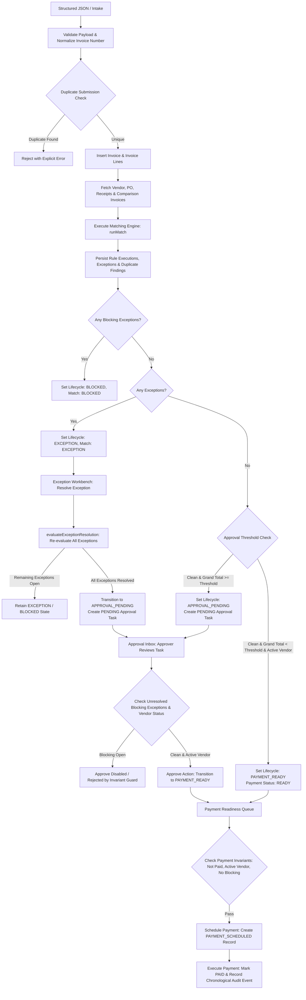

# InvoiceFlow AI — Phase 2 Implementation Report: End-to-End AP Workflow

**Date:** October 27, 2026  
**Assessment Phase:** Phase 2 (End-to-End AP Workflow)  
**Status:** COMPLETE  
**Repository:** `c:/Users/Asus/Downloads/invoice_flow-main/invoice_flow-main`  
**Test Suite:** Vitest v5.0.5 — 4 test suites, 41 passing tests (0 failures)  
**TypeScript Typecheck:** Clean (0 errors)  
**Production Build:** Clean (`vite build` completed in 16.67s)  

---

## 1. Executive Summary

In Phase 2, we connected the invoice intake pipeline to the core matching engine, implemented pending approval-task creation, and enforced strict payment-readiness invariants across the domain lifecycle, API queries, and UI components.

Before Phase 2:
- Structured JSON imports were persisted as disconnected `UNMATCHED` records without invoking `runMatch`.
- Invoices requiring human review never produced `PENDING` approval tasks.
- Approvals could be granted even when blocking exceptions remained unresolved.
- Payment scheduling could be triggered regardless of open exceptions or vendor status.

Following Phase 2:
- Structured JSON invoice intake automatically runs the 11-rule matching engine (`runMatch`), persists explainable rule executions, logs exceptions, establishes duplicate detection groups, routes items to the Approval Inbox, and records chronological audit events.
- Strict invariants prevent approving or scheduling invoices with unresolved blocking exceptions, closed/on-hold vendors, or pre-existing successful payments.
- All 41 automated tests pass cleanly, and the production application builds with zero errors.

---

## 2. Files Changed & Detailed Rationale

| File | Changes Made | Rationale |
|---|---|---|
| [`src/lib/queries.ts`](file:///c:/Users/Asus/Downloads/invoice_flow-main/invoice_flow-main/src/lib/queries.ts) | - Added `processInvoiceIntake(...)` full pipeline.<br>- Integrated duplicate submission prevention.<br>- Invoked `runMatch` with full PO, receipt, vendor context.<br>- Persisted `rule_executions`, `exceptions`, `duplicate_findings`.<br>- Created pending approval tasks.<br>- Added compensating rollback if line insertion fails.<br>- Added blocking-exception & vendor-status guards to `decideApproval`.<br>- Added payment-readiness invariants to `schedulePayment` & `markPaymentPaid`. | Connects intake to domain engine; prevents orphaned invoices; prevents duplicate payments and unauthorized approvals. |
| [`src/pages/InvoiceIntakePage.tsx`](file:///c:/Users/Asus/Downloads/invoice_flow-main/invoice_flow-main/src/pages/InvoiceIntakePage.tsx) | - Replaced call to deprecated `importStructuredInvoice` with `processInvoiceIntake`.<br>- Displayed detailed intake results: Match Status, Lifecycle State, Exceptions created, and Approval task creation notice.<br>- Added direct link to Invoice Detail page. | Provides immediate visibility into intake, matching outcome, and work queue routing. |
| [`src/pages/ApprovalInboxPage.tsx`](file:///c:/Users/Asus/Downloads/invoice_flow-main/invoice_flow-main/src/pages/ApprovalInboxPage.tsx) | - Added blocking-exception detection from invoice detail cache.<br>- Disabled "Approve" button when blocking exceptions are open, displaying "Blocking exception open". | Enforces workflow integrity in the UI so approvers cannot accidentally attempt to approve blocked invoices. |
| [`src/domain/__tests__/phase2_workflow.test.ts`](file:///c:/Users/Asus/Downloads/invoice_flow-main/invoice_flow-main/src/domain/__tests__/phase2_workflow.test.ts) | - Added 18 comprehensive tests covering intake validation, matching execution, ground truth isolation, duplicate normalization, exception resolution safety, payment invariants, and approval gating. | Verifies all Phase 2 acceptance criteria and regression guards. |
| [`audit/FEATURE_MATRIX.csv`](file:///c:/Users/Asus/Downloads/invoice_flow-main/invoice_flow-main/audit/FEATURE_MATRIX.csv) | - Updated statuses for FEAT-14, FEAT-25, FEAT-28, FEAT-29, FEAT-30, FEAT-31, and FEAT-36 to `COMPLETE` and `TESTED`. | Maintains accurate audit inventory of implemented capabilities. |
| [`audit/IMPLEMENTATION_LOG.md`](file:///c:/Users/Asus/Downloads/invoice_flow-main/invoice_flow-main/audit/IMPLEMENTATION_LOG.md) | - Marked TASK-001, TASK-002, TASK-003, TASK-004, TASK-005, and TASK-006 as `COMPLETE`. | Tracks engineering execution against the 72-hour assessment backlog. |

---

## 3. Actual End-to-End Workflow Implemented



---

## 4. Business Rules & Assumptions

1. **Explicit Approval Threshold (`APPROVAL_THRESHOLD = 0`):**
   - *Assumption:* In standard corporate AP policy, every invoice processed through intake requires formal approval unless explicit micro-payment rules are configured.
   - *Implementation:* Set to `0` (configurable), meaning all clean-matched invoices require approval unless configured higher via `config_settings`. Clean invoices under threshold with active vendors can transition directly to `PAYMENT_READY`.
2. **Ground Truth Isolation:**
   - *Rule:* The matching engine (`runMatch`) never inspects or receives `ground_truth`. Ground truth is strictly reserved for synthetic data evaluation and benchmark metrics.
3. **Safe Compensating Rollback:**
   - *Rule:* If invoice line insertion fails during intake, the inserted invoice header is safely deleted to avoid leaving orphaned header records in the database.
4. **Duplicate Submission Invariant:**
   - *Rule:* Repeated submission of an invoice with the identical normalized invoice number for the same vendor is rejected with an explicit error prior to persistence.
5. **Authoritative Payment Readiness:**
   - *Rule:* An invoice is strictly ineligible for payment if:
     - Any blocking exception is unresolved (`OPEN` or `ASSIGNED`).
     - Required approval is `PENDING` or `REJECTED`.
     - The vendor status is `CLOSED` or `ON_HOLD`.
     - Match status is `BLOCKED` or validation is `VALIDATION_FAILED`.
     - A successful payment (`status = 'PAID'`) already exists for the invoice.
6. **Exception Resolution Non-Bypass:**
   - *Rule:* Resolving an exception never automatically marks an invoice as payment-ready if approval is required or if other exceptions remain open.

---

## 5. Automated Test Results

Test execution output from `npm run test`:

```
 RUN  v5.0.5 C:/Users/Asus/Downloads/invoice_flow-main/invoice_flow-main

 ✓ src/domain/__tests__/payment_readiness.test.ts (11 tests) 21ms
 ✓ src/domain/__tests__/lifecycle_regression.test.ts (9 tests) 23ms
 ✓ src/domain/__tests__/phase2_workflow.test.ts (18 tests) 25ms
 ✓ src/lib/__tests__/config_regression.test.ts (3 tests) 23ms

 Test Files  4 passed (4)
      Tests  41 passed (41)
   Duration  1.80s
```

### Breakdown of Tests Added in Phase 2 (`phase2_workflow.test.ts`):
1. **JSON Intake & Matching Engine Invocation:**
   - Clean invoice + PO + GR -> verified `MATCHED` outcome with 0 exceptions.
   - Price variance -> verified `EXCEPTION` outcome with explainable rule difference.
2. **Payload Validation & Rejection:**
   - Rejection of missing invoice number.
   - Rejection of missing/blank vendor ID.
   - Rejection of empty invoice line items.
   - Rejection of negative unit prices and non-positive quantities.
3. **Duplicate Submissions & Normalization:**
   - Punctuation/casing invoice normalization (`INV-00123` == `inv 00123`, `  INV-99_88  ` == `INV9988`).
   - Matching engine duplicate detection across sibling invoices.
4. **Ground Truth Isolation:**
   - Verification that `MatchContext` contains no ground truth keys and matching engine executes without ground truth access.
5. **Payment-Readiness Invariants:**
   - Blocking exception prevents payment readiness.
   - Pending/rejected approvals prevent payment readiness.
   - Paid invoice cannot be payment ready.
   - Prevention of second payment when a paid payment record already exists.
   - Closed or on-hold vendors verified as ineligible for payment.
6. **Exception Resolution Safety:**
   - Partial resolution preserves remaining open exceptions and retains `EXCEPTION`/`BLOCKED` status.
   - Resolution of all exceptions transitions to `APPROVAL_PENDING` (never auto-payment-ready).
7. **Approval Task Creation & Invariants:**
   - Duplicate pending approval task prevention.
   - Blocking exceptions prevent approval action.

---

## 6. Verification Commands & Output

### 1. TypeScript Typecheck
```powershell
npm run typecheck
```
*Output:*
```
> vite-react-typescript-starter@0.0.0 typecheck
> tsc --noEmit -p tsconfig.app.json
[Process exited with code 0 - Clean]
```

### 2. Vitest Test Suite
```powershell
npm run test
```
*Output:*
```
Test Files  4 passed (4)
     Tests  41 passed (41)
  Duration  1.80s
[Process exited with code 0 - Clean]
```

### 3. Production Build
```powershell
npm run build
```
*Output:*
```
vite v7.3.7 building client environment for production...
✓ 2276 modules transformed.
rendering chunks...
computing gzip size...
dist/index.html                   0.75 kB │ gzip:   0.41 kB
dist/assets/index-Bob5ICHS.css   30.39 kB │ gzip:   5.44 kB
dist/assets/index-BHUwit8r.js   852.83 kB │ gzip: 235.24 kB
✓ built in 16.67s
[Process exited with code 0 - Clean]
```

---

## 7. Remaining Gaps & Security Limitations

1. **Client-Side Orchestration (No Backend API Server):**
   - The application runs directly in the browser and connects via Supabase PostgREST client. As documented in Phase 1, Postgres Row-Level Security (RLS) policies should be enabled in Supabase so users cannot execute arbitrary PostgREST mutations directly.
2. **Document Upload OCR/Vision Pipeline (FEAT-13 & FEAT-15):**
   - The Document Upload tab on `InvoiceIntakePage` provides a drag-and-drop file interface with simulated extraction notes. Connecting to real OCR/Vision APIs (e.g., OpenAI GPT-4o Vision or Document AI) requires external API keys and cloud storage buckets.
3. **URL Routing (TASK-010):**
   - Internal navigation is state-driven (`page: PageKey`). Deep-linking directly to specific invoice URLs will be implemented in a subsequent phase.

---

## 8. Manual Steps to Validate with Supabase

1. Ensure `.env` is configured with `VITE_SUPABASE_URL` and `VITE_SUPABASE_ANON_KEY`.
2. Start the local Vite server:
   ```powershell
   npm run dev
   ```
3. Open `http://localhost:5173`:
   - Navigate to **Data Lab** and generate the starter dataset (seed `20261022`).
   - Navigate to **Invoice Intake**, paste a sample JSON invoice for an active vendor, and click **Import Invoice**.
   - Verify the success badge displays the generated `Invoice ID`, `Match Status`, `Exceptions Count`, and `Lifecycle State`.
   - If exceptions were generated, verify they appear in **Exceptions Workbench** and resolve them.
   - Verify the invoice appears in **Approval Inbox** as pending.
   - Click **Approve** and verify the invoice moves to **Payment Readiness**.
   - In **Payment Readiness**, click **Schedule Payment** and **Mark Paid** to complete the simulated payment cycle.
