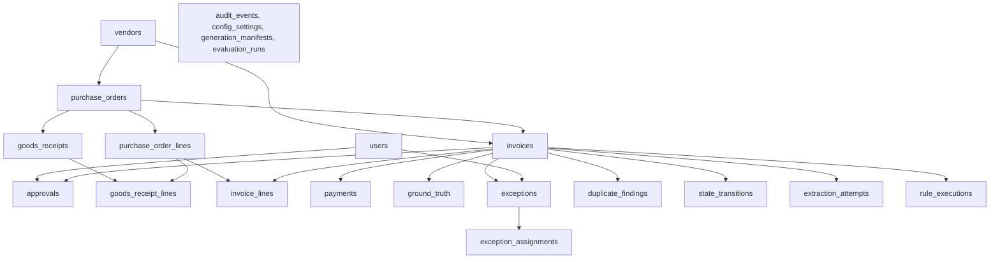

# InvoiceFlow AI — Supabase Database Setup & Migration Audit

**Document Date:** October 28, 2026  
**Status:** DIAGNOSIS COMPLETE — ACTION REQUIRED IN SUPABASE SQL EDITOR  
**Affected Service:** Supabase PostgREST & Data Lab (`DataLabPage.tsx`)  
**Target Environment:** Supabase Cloud Project (PostgreSQL 15+)  

---

## 1. Executive Summary & Root-Cause Diagnosis

### 1.1 The Reported Error
When navigating to **Data Lab** in InvoiceFlow AI, the application reports:
```text
Could not find the table 'public.ground_truth' in the schema cache
```
(PostgREST error code: `PGRST205`)

### 1.2 Root Cause
1. **Connection Established:** The application successfully connects to the Supabase URL specified in `.env`.
2. **Missing Database Objects:** The PostgreSQL schema migrations located under `supabase/migrations/` have not yet been executed in the connected Supabase project.
3. **Data Lab Initial Load Sequence:** Upon opening `DataLabPage.tsx`, the page runs:
   ```ts
   Promise.all([fetchManifests(), fetchGroundTruth(), getDatasetSummary()])
   ```
   `fetchGroundTruth()` queries `supabase.from('ground_truth').select('*')` while `fetchManifests()` queries `supabase.from('generation_manifests').select('*')`. Because neither table exists in PostgreSQL, PostgREST halts with `PGRST205`.
4. **Current Verification Results:** An automated probe of all 21 operational tables and RPC stored procedures revealed that **0 of 21 tables** and **0 of 2 RPC functions** currently exist in the PostgREST schema cache (see Section 6 for full diagnostic logs).

---

## 2. Ordered List of Migrations

To establish the schema on a fresh Supabase project, the migrations **must** be executed in the exact chronological order below:

| Sequence | Migration File | Primary Purpose | Key Contents |
|---|---|---|---|
| **1st** | [`supabase/migrations/20261027155808_001_invoiceflow_core_schema.sql`](file:///c:/Users/Asus/Downloads/invoice_flow-main/invoice_flow-main/supabase/migrations/20261027155808_001_invoiceflow_core_schema.sql) | **Core Schema & Initial RLS** | Creates all 21 operational tables in topological dependency order, establishes primary/foreign keys, sets up Row-Level Security (RLS) policies, indexes, and the `set_updated_at` trigger. |
| **2nd** | [`supabase/migrations/20261027180000_002_security_hardening_and_invariants.sql`](file:///c:/Users/Asus/Downloads/invoice_flow-main/invoice_flow-main/supabase/migrations/20261027180000_002_security_hardening_and_invariants.sql) | **Security Hardening & Invariants** | Adds database-level CHECK constraints (non-negative pricing/quantities/totals, valid due dates), partial unique indexes (preventing double payments), append-only immutability triggers for audit events, and `SECURITY DEFINER` stored procedures (`decide_approval_secure`, `schedule_payment_secure`). |

> [!IMPORTANT]
> Migration `002` depends directly on tables created in Migration `001` (`invoices`, `payments`, `approvals`, `invoice_lines`, `purchase_order_lines`, `goods_receipt_lines`, `audit_events`, `state_transitions`, and `users`). Executing migration `002` before `001` will fail.

---

## 3. Deep Dive: `public.ground_truth` Analysis

### 3.1 Table Definition
`public.ground_truth` is defined in **Migration 001** (`20261027155808_001_invoiceflow_core_schema.sql`, lines 520–538):

```sql
CREATE TABLE IF NOT EXISTS ground_truth (
  invoice_id text PRIMARY KEY REFERENCES invoices(invoice_id) ON DELETE CASCADE,
  scenario_label text NOT NULL,
  expected_match_outcome text NOT NULL,
  expected_exception_codes text[],
  expected_duplicate_group text,
  expected_approval_eligible boolean NOT NULL DEFAULT false,
  expected_payment_ready boolean NOT NULL DEFAULT false,
  expected_payment_outcome text,
  notes text
);

ALTER TABLE ground_truth ENABLE ROW LEVEL SECURITY;
GRANT SELECT, INSERT, UPDATE, DELETE ON ground_truth TO anon, authenticated, service_role;

DROP POLICY IF EXISTS "anon_gt_s" ON ground_truth;
CREATE POLICY "anon_gt_s" ON ground_truth FOR SELECT TO anon, authenticated USING (true);
CREATE POLICY "anon_gt_i" ON ground_truth FOR INSERT TO anon, authenticated WITH CHECK (true);
CREATE POLICY "anon_gt_u" ON ground_truth FOR UPDATE TO anon, authenticated USING (true) WITH CHECK (true);
CREATE POLICY "anon_gt_d" ON ground_truth FOR DELETE TO anon, authenticated USING (true);

CREATE INDEX IF NOT EXISTS idx_gt_scenario ON ground_truth(scenario_label);
```

### 3.2 Key Properties & Verification
- **Primary Key:** `invoice_id` (1:1 relationship with `invoices.invoice_id`).
- **Cascade Behavior:** `ON DELETE CASCADE` ensures that clearing or removing test invoices automatically cleans up corresponding ground truth entries.
- **Index:** `idx_gt_scenario` accelerates scenario-based filtering in Data Lab evaluation views.
- **RLS Access:** Row-Level Security is enabled, with permissive CRUD policies for `anon` and `authenticated` roles because synthetic generation runs directly in the client.
- **Subsequent Migrations:** Migration `002` was audited line-by-line; **it does not modify, alter, or drop `ground_truth`**.
- **Architectural Boundary:** As documented in `src/domain/generator.ts` and `src/lib/queries.ts`, `ground_truth` is strictly segregated from operational decision logic: the automated 3-way matching engine never reads `ground_truth`. It is only used post-matching to calculate precision, recall, and scenario accuracy.

---

## 4. Full Table & Dependency Requirements for Data Lab

Before Data Lab can generate or view synthetic datasets, the following 21 tables must exist. When the user clicks **Generate Synthetic Dataset**, `seedDataset()` in `src/lib/seed.ts` clears existing records and inserts fresh demo data in this exact topological order:



### 4.1 Dependency Checklist

1. **Foundational Masters:**
   - `users`: AP roles (Business Requester, Approver, Process Owner, Operations Analyst, System Admin).
   - `vendors`: Vendor master records, tax IDs, payment terms.
2. **Purchase Orders & Receipts:**
   - `purchase_orders`: PO headers linked to `vendors`.
   - `purchase_order_lines`: PO line items with quantities and prices.
   - `goods_receipts`: Delivery receipts linked to POs.
   - `goods_receipt_lines`: Received/accepted quantities referencing `purchase_order_lines`.
3. **Invoices:**
   - `invoices`: Invoice headers linked to `vendors` and `purchase_orders`.
   - `invoice_lines`: Line items referencing `purchase_order_lines`.
4. **Lifecycle & Matching:**
   - `approvals`: Approval workflows assigned to `users`.
   - `payments`: Scheduled/paid disbursements.
   - `ground_truth`: Scenario benchmark labels (1:1 with `invoices`).
   - `exceptions`: Rule failure findings.
   - `exception_assignments`: History of assignments and resolutions.
   - `duplicate_findings`: Detected pairs/groups of potential duplicate invoices.
   - `rule_executions`: Per-rule pass/fail explanations.
   - `state_transitions`: Complete lifecycle history.
   - `extraction_attempts`: Simulated OCR/extraction confidence.
5. **System & Analytics:**
   - `audit_events`: Append-only compliance log.
   - `config_settings`: Business matching tolerances.
   - `generation_manifests`: Seed, scale, scenario counts, and reproducibility checksums.
   - `evaluation_runs`: Aggregate accuracy, precision, and recall metrics.

---

## 5. Safe Instructions for Supabase SQL Editor

These migrations are engineered with safety guards:
- `CREATE TABLE IF NOT EXISTS`: Does not overwrite or drop existing tables.
- `CREATE INDEX IF NOT EXISTS`: Prevents index naming conflicts.
- `DO $$ BEGIN IF NOT EXISTS (...) THEN ALTER TABLE ... ADD CONSTRAINT ... END IF; END $$;`: Checks constraint existence before altering.
- `CREATE OR REPLACE FUNCTION`: Idempotently updates stored procedures without data disruption.
- **Zero data loss:** There are no `DROP TABLE`, `TRUNCATE`, or `DROP SCHEMA` statements.

### Step-by-Step Application Procedure

#### Step 1: Open Supabase SQL Editor
1. Log in to the [Supabase Dashboard](https://supabase.com/dashboard).
2. Select your InvoiceFlow AI project.
3. In the left navigation bar, click **SQL Editor** (icon: `>_`).
4. Click **+ New query**.

#### Step 2: Apply Migration 001 (Core Schema)
1. Open [`supabase/migrations/20261027155808_001_invoiceflow_core_schema.sql`](file:///c:/Users/Asus/Downloads/invoice_flow-main/invoice_flow-main/supabase/migrations/20261027155808_001_invoiceflow_core_schema.sql) in your code editor.
2. Copy the entire file content.
3. Paste it into the Supabase SQL Editor query window.
4. Click **Run** (or press `Ctrl+Enter` / `Cmd+Enter`).
5. Confirm the response: **"Success. No rows returned"** (or execution summary).

#### Step 3: Apply Migration 002 (Security Hardening & Invariants)
1. Open [`supabase/migrations/20261027180000_002_security_hardening_and_invariants.sql`](file:///c:/Users/Asus/Downloads/invoice_flow-main/invoice_flow-main/supabase/migrations/20261027180000_002_security_hardening_and_invariants.sql) in your code editor.
2. Copy the entire file content.
3. In Supabase SQL Editor, click **+ New query**, paste the SQL, and click **Run**.
4. Confirm the response: **"Success. No rows returned"**.

---

## 6. How to Reload the PostgREST Schema Cache Safely

PostgREST inspects PostgreSQL's `information_schema` at startup and builds an in-memory schema cache. Although Supabase automatically listens for DDL changes via PostgreSQL triggers, schema cache propagation can occasionally delay or stall.

If the migrations have executed but the app still reports `Could not find the table ... in the schema cache`, follow these safe reload methods:

### Method A: Execute Cache Reload via SQL (Fastest)
In Supabase SQL Editor, create a new query and run:
```sql
NOTIFY pgrst, 'reload schema';
```
*(Optionally also run `NOTIFY pgrst, 'reload config';`)*  
PostgREST instantly rebuilds its schema cache in memory without dropping connections or restarting the database.

### Method B: Reload via Dashboard UI
1. In the Supabase Dashboard, click the **Settings** (gear icon) in the left sidebar.
2. Select **API** under the Configuration group.
3. Under the **PostgREST Configuration** section, locate the **Schema Cache** setting.
4. Click **Reload schema cache**.

### Method C: Confirm Data API Schema Exposure
If tables remain unexposed:
1. In **Settings -> API**, scroll to **Exposed schemas**.
2. Verify that `public` is listed in the exposed schemas list.
3. Under **Database -> Tables**, confirm all 21 tables appear with Row Level Security enabled.

---

## 7. Current Pre-Application Verification Audit

An automated connectivity check was executed against the configured Supabase instance using `vitest run src/check_db.test.ts`.

### Pre-Application Test Results

| Table / RPC | Checked Entity | Status | PostgREST Code |
|---|---|---|---|
| 1 | `public.users` | ❌ FAILED | `PGRST205` (Not in schema cache) |
| 2 | `public.vendors` | ❌ FAILED | `PGRST205` (Not in schema cache) |
| 3 | `public.purchase_orders` | ❌ FAILED | `PGRST205` (Not in schema cache) |
| 4 | `public.purchase_order_lines` | ❌ FAILED | `PGRST205` (Not in schema cache) |
| 5 | `public.goods_receipts` | ❌ FAILED | `PGRST205` (Not in schema cache) |
| 6 | `public.goods_receipt_lines` | ❌ FAILED | `PGRST205` (Not in schema cache) |
| 7 | `public.invoices` | ❌ FAILED | `PGRST205` (Not in schema cache) |
| 8 | `public.invoice_lines` | ❌ FAILED | `PGRST205` (Not in schema cache) |
| 9 | `public.approvals` | ❌ FAILED | `PGRST205` (Not in schema cache) |
| 10 | `public.payments` | ❌ FAILED | `PGRST205` (Not in schema cache) |
| 11 | `public.exceptions` | ❌ FAILED | `PGRST205` (Not in schema cache) |
| 12 | `public.exception_assignments` | ❌ FAILED | `PGRST205` (Not in schema cache) |
| 13 | `public.duplicate_findings` | ❌ FAILED | `PGRST205` (Not in schema cache) |
| 14 | `public.audit_events` | ❌ FAILED | `PGRST205` (Not in schema cache) |
| 15 | `public.state_transitions` | ❌ FAILED | `PGRST205` (Not in schema cache) |
| 16 | `public.extraction_attempts` | ❌ FAILED | `PGRST205` (Not in schema cache) |
| 17 | `public.config_settings` | ❌ FAILED | `PGRST205` (Not in schema cache) |
| 18 | `public.generation_manifests` | ❌ FAILED | `PGRST205` (Not in schema cache) |
| 19 | `public.evaluation_runs` | ❌ FAILED | `PGRST205` (Not in schema cache) |
| 20 | `public.ground_truth` | ❌ FAILED | `PGRST205` (Not in schema cache) |
| 21 | `public.rule_executions` | ❌ FAILED | `PGRST205` (Not in schema cache) |
| RPC 1 | `decide_approval_secure` | ❌ MISSING | `PGRST202` (Function not found) |
| RPC 2 | `schedule_payment_secure` | ❌ MISSING | `PGRST202` (Function not found) |

**Summary:** **0 / 21 tables** exist; **0 / 2 stored procedures** exist.

---

## 8. Post-Application Verification Procedure

Once you execute Migration 001 and Migration 002 in Supabase SQL Editor:

1. Run the automated verification command in your project terminal:
   ```bash
   npm run verify:db
   ```
2. Expected output upon successful migration:
   ```text
   --- TABLE VERIFICATION REPORT ---
   users                    : PASS: Table exists and is accessible
   vendors                  : PASS: Table exists and is accessible
   purchase_orders          : PASS: Table exists and is accessible
   purchase_order_lines     : PASS: Table exists and is accessible
   goods_receipts           : PASS: Table exists and is accessible
   goods_receipt_lines      : PASS: Table exists and is accessible
   invoices                 : PASS: Table exists and is accessible
   invoice_lines            : PASS: Table exists and is accessible
   approvals                : PASS: Table exists and is accessible
   payments                 : PASS: Table exists and is accessible
   exceptions               : PASS: Table exists and is accessible
   exception_assignments    : PASS: Table exists and is accessible
   duplicate_findings       : PASS: Table exists and is accessible
   audit_events             : PASS: Table exists and is accessible
   state_transitions        : PASS: Table exists and is accessible
   extraction_attempts      : PASS: Table exists and is accessible
   config_settings          : PASS: Table exists and is accessible
   generation_manifests     : PASS: Table exists and is accessible
   evaluation_runs          : PASS: Table exists and is accessible
   ground_truth             : PASS: Table exists and is accessible
   rule_executions          : PASS: Table exists and is accessible

   Tables verified: 21 / 21 exist.
   decide_approval_secure   : PASS (Function found)
   schedule_payment_secure  : PASS (Function found)
   ```
3. Return to the InvoiceFlow AI application in your browser and reload **Data Lab**:
   - The banner `Could not find the table 'public.ground_truth' in the schema cache` will be gone.
   - Click **Generate Synthetic Dataset (Starter)** to populate operational records and benchmark ground truth.
